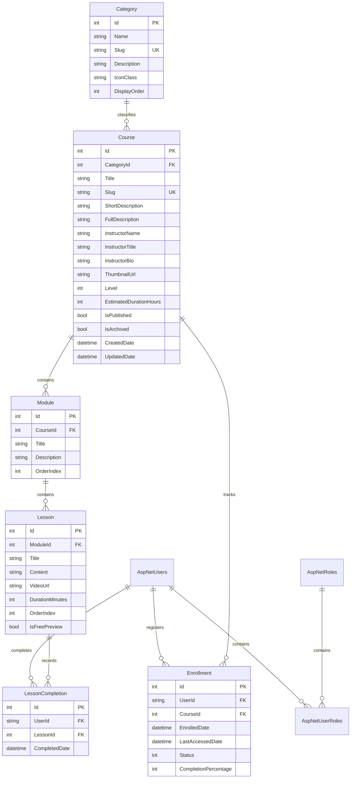

# LMSPortal — Enterprise Learning Management System Blueprint

[](https://dotnet.microsoft.com/)
[](https://dotnet.microsoft.com/apps/aspnet/mvc)
[](https://learn.microsoft.com/ef/ef6/)
[](https://learn.microsoft.com/aspnet/identity/)
[](https://getbootstrap.com/)
[](https://learn.microsoft.com/visualstudio/test/)
[](LICENSE)

An enterprise-grade, full-featured **Learning Management System (LMS)** built with **ASP.NET MVC 5**, **C#**, **Entity Framework 6 Code First**, and **SQL Server**. LMSPortal delivers an end-to-end e-learning platform with multi-tenant role authorization, a structured modular curriculum engine, an immersive media player with progress tracking, and a comprehensive administrative governance console.

---

## Table of Contents

- [System Overview](#system-overview)
- [Local Interface & Invariants](#local-interface--invariants)
- [Subdirectories & System Boundaries](#subdirectories--system-boundaries)
- [Global Invariants](#global-invariants)
- [Global Side Effects](#global-side-effects)
- [System Verification](#system-verification)
- [Key Features](#key-features)
- [Technology Stack](#technology-stack)
- [Database Schema & Domain Model](#database-schema--domain-model)
- [Directory Structure](#directory-structure)
- [Getting Started](#getting-started)
- [Default Demo Accounts](#default-demo-accounts)
- [Testing & Quality Assurance](#testing--quality-assurance)
- [Engineering Standards & Best Practices](#engineering-standards--best-practices)
- [License](#license)

---

## System Overview

LMSPortal follows the classic **Model-View-Controller (MVC)** architectural pattern combined with **Domain-Driven Design (DDD)** principles and **ASP.NET Identity** for token-based cookie authentication.

```
                     +---------------------------------------+
                     |         Browser / Client UI           |
                     |  Bootstrap 5.2 + jQuery + Validation  |
                     +---------------------------------------+
                                         |
                                         v
                     +---------------------------------------+
                     |          OWIN Middleware Pipeline     |
                     | Cookie Auth | Security Headers | CSRF |
                     +---------------------------------------+
                                         |
                   +---------------------+---------------------+
                   |                                           |
                   v                                           v
+------------------------------------+     +-------------------------------------+
|        Student / Public Area       |     |       Admin Area (/Admin)           |
| Account | Course | Learning | Home |     | Course | Category | Module | Student|
+------------------------------------+     +-------------------------------------+
                   |                                           |
                   +---------------------+---------------------+
                                         |
                                         v
                     +---------------------------------------+
                     |       Domain & View Models Layer      |
                     |  Course, Module, Lesson, Enrollment   |
                     +---------------------------------------+
                                         |
                                         v
                     +---------------------------------------+
                     |       Entity Framework 6 (DAL)        |
                     |   ApplicationDbContext | Migrations   |
                     +---------------------------------------+
                                         |
                                         v
                     +---------------------------------------+
                     |         Microsoft SQL Server          |
                     |       (LocalDB / SQLEXPRESS)          |
                     +---------------------------------------+
```

---

## Local Interface & Invariants

- `[Global.asax.cs:MvcApplication]` `public class MvcApplication : System.Web.HttpApplication`
  - `Application_Start()`: Boots automatic database migrations via `MigrateDatabaseToLatestVersion<ApplicationDbContext, Migrations.Configuration>()`, registers areas, filters, routes, and script/style bundles, and binds anti-forgery tokens to `ClaimTypes.NameIdentifier`.
  - `Application_Error()`: Intercepts `HttpAntiForgeryException` and gracefully redirects expired or tampered sessions to `~/Account/Login`.
- `[Startup.cs:Startup]` `public partial class Startup`
  - `Configuration(IAppBuilder app)`: Entry point for OWIN pipeline bootstrapping, delegating authentication middleware setup to `ConfigureAuth(app)`.

---

## Subdirectories & System Boundaries

- [App_Start](./App_Start/README.md) - Core application bootstrap routines, OWIN auth middleware, bundle tables, and route definitions.
- [Areas](./Areas/README.md) - Modular application boundaries, encapsulating the administrative back-office subsystem ([Admin](./Areas/Admin/README.md)).
- [Controllers](./Controllers/README.md) - Public storefront, student dashboard, course catalog, enrollment transactions, and learning player MVC controllers.
- [Migrations](./Migrations/README.md) - Entity Framework Code First database migrations and initial database seeder pipeline.
- [Models](./Models/README.md) - Core domain entities, relationships, database contexts, and seed data definitions.
- [Security](./Security/README.md) - Cryptographic security utilities and high-entropy password generation.
- [ViewModels](./ViewModels/README.md) - Strongly-typed presentation models and DTOs for client-side forms and UI views.

---

## Global Invariants

- **Role & Route Isolation**: All routes under `/Admin` strictly require `[Authorize(Roles = "Admin")]`. Student portal routes require authenticated identity; only catalog browsing and designated `IsFreePreview` lessons permit anonymous access.
- **CSRF & Tamper Protection**: All state-modifying POST actions require `@Html.AntiForgeryToken()`. `AntiForgeryConfig.UniqueClaimTypeIdentifier` is pinned to `ClaimTypes.NameIdentifier`.
- **Referential Learning History Integrity**: Historical enrollments and student lesson completions are safeguarded against cascading deletion on courses or user accounts (`WillCascadeOnDelete(false)`). Deleting a course with active student enrollments is strictly prohibited.
- **Slug Uniqueness**: Slugs for categories (`IX_Category_Slug`) and courses (`IX_Course_Slug`) maintain unique database constraints.
- **Anti-Mojibake Globalization**: UTF-8 request, response, and file encodings are globally enforced in `Web.config` under `<system.web>`.

---

## Global Side Effects

- **Database State Persistence**: Modifies SQL Server database tables (`AspNetUsers`, `AspNetRoles`, `Courses`, `Modules`, `Lessons`, `Categories`, `Enrollments`, `LessonCompletions`) via Entity Framework 6 `SaveChanges`.
- **Authentication Cookies**: Sets and invalidates `LMSPortal_Auth` HTTP-only session cookies with sliding 8-hour expiration.

---

## System Verification

- Run test suite:
  ```powershell
  & "C:\Program Files\Microsoft Visual Studio\18\Community\Common7\IDE\CommonExtensions\Microsoft\TestWindow\vstest.console.exe" "D:\Projects\.NET\LMSPortal\LMSPortal.Tests\bin\Debug\net48\LMSPortal.Tests.dll"
  ```

---

## Key Features

### Public Course Catalog
- **Course Discovery & Search**: Full-text searching across course titles, instructor names, and descriptions.
- **Parametric Filtering**: Dynamic filtering by category slug (`category`), proficiency level (`Beginner`, `Intermediate`, `Advanced`, `AllLevels`), and sorting criteria (`Popularity`, `Newest`, `Alphabetical`).
- **Comprehensive Course Details**: Syllabus preview, instructor biography, course duration metrics, and free preview indicators.
- **SEO-Friendly URLs**: Human-readable URL slugs (`/courses/{slug}`) indexed uniquely in SQL Server.

### Student Learning Experience
- **Dedicated Student Dashboard** (`/student/dashboard`): Visual progress tracking with percentage meters, last-accessed timestamps, and one-click course resumption.
- **Immersive Learning Player** (`/learning/{courseId}/{lessonId}`):
  - Collapsible curriculum navigation sidebar with completed lesson badges.
  - Video player supporting embedded YouTube, Vimeo, and direct MP4 streams.
  - Rich Markdown / HTML lesson content rendering.
  - Free preview access control for unauthenticated visitors.
  - **Dynamic Progress Engine**: Automatically calculates and persists completion percentages (`0–100%`) as students complete individual lessons.

### Administrative Governance Area
Dedicated administrative back-office mounted at `/Admin` and secured by role-based authorization (`[Authorize(Roles = "Admin")]`):
- **Executive KPI Dashboard**: Real-time counts of total courses, published vs. draft items, enrolled students, global completion rates, and an audit feed of recent enrollments.
- **Course Management**: Full CRUD operations, slug auto-generation, thumbnail image management, publishing lifecycle controls, and archival flags.
- **Curriculum Builder**: Hierarchical organization of courses into **Modules** and ordered **Lessons**.
- **Category Management**: Taxonomy organization with custom icon classes and display sequence sorting.
- **Student Progress Auditing**: Granular enrollment inspection per student.

### Security & Access Control
- **ASP.NET Identity 2.2.4**: Cryptographic PBKDF2 password hashing, claims-based authorization, and sliding expiration authentication cookies.
- **OWIN Middleware**: Session and security cookie isolation preventing session-hijacking and cross-site scripting (XSS).
- **Anti-Forgery Token Protection**: Native `@Html.AntiForgeryToken()` validation enforced across all mutating POST endpoints.
- **Account Lockout Policy**: Configured to lock accounts for 5 minutes after 5 consecutive failed login attempts.
- **Cryptographic Password Seeder**: Automatically provisions random 16-character administrator credentials via `RNGCryptoServiceProvider` when not supplied via environment variables.

---

## Technology Stack

| Layer | Component | Version / Details |
|---|---|---|
| **Runtime / Framework** | Microsoft .NET Framework | `4.8` |
| **Web Framework** | ASP.NET MVC | `5.2.9` |
| **Data Access / ORM** | Entity Framework Code First | `6.4.4` |
| **Database** | Microsoft SQL Server / LocalDB | `(localdb)\MSSQLLocalDB` / `SQLEXPRESS` |
| **Authentication** | ASP.NET Identity & OWIN Security | `2.2.4` / `4.2.2` |
| **Client UI Framework** | Bootstrap | `5.2.3` (with bundled Popper.js) |
| **Icons & Media** | Bootstrap Icons | `1.11.0` |
| **Client Scripting** | jQuery & Unobtrusive Validation | `3.7.0` / `3.2.11` |
| **Asset Optimization** | WebGrease & Microsoft Optimization | `1.6.0` / `1.1.3` |
| **Unit Testing** | MSTest v2 | `2.2.10` |

---

## Database Schema & Domain Model



---

## Directory Structure

```text
LMSPortal/
│
├── App_Start/                          # Core application bootstrap routines
│   ├── BundleConfig.cs                 # Script & style bundling definitions
│   ├── FilterConfig.cs                 # Global MVC action filters
│   ├── IdentityConfig.cs               # ASP.NET Identity UserManager & SignInManager
│   ├── RouteConfig.cs                  # MVC URL route table & attribute routing
│   ├── Startup.Auth.cs                 # OWIN cookie authentication & OAuth setup
│   └── README.md                       # EGM Component Contract
│
├── Areas/
│   ├── README.md                       # EGM Intermediate Blueprint
│   └── Admin/                          # Administrative sub-system
│       ├── Controllers/                # Admin controllers (Dashboard, Course, Category, etc.)
│       │   └── README.md               # EGM Component Contract
│       ├── ViewModels/                 # Back-office view presentation models
│       │   └── README.md               # EGM Component Contract
│       ├── Views/                      # Admin Razor templates
│       ├── AdminAreaRegistration.cs    # Admin route partition setup
│       └── README.md                   # EGM Subsystem Contract
│
├── Controllers/                        # Public & student MVC controllers
│   ├── AccountController.cs            # Login, registration, lockout, sign-out
│   ├── CourseController.cs             # Course catalog, search, and filtering
│   ├── EnrollmentController.cs         # Student enrollment transactions
│   ├── HomeController.cs               # Landing page, about, contact
│   ├── LearningController.cs           # Interactive student player & progress tracker
│   ├── StudentController.cs            # Student dashboard & course overview
│   └── README.md                       # EGM Component Contract
│
├── Migrations/                         # Entity Framework Code First migrations
│   ├── Configuration.cs                # Migration seed pipeline configuration
│   └── README.md                       # EGM Component Contract
│
├── Models/                             # Domain entities & database contexts
│   ├── ApplicationDbContext.cs         # EF6 DbContext implementation
│   ├── Category.cs                     # Course taxonomy entity
│   ├── Course.cs                       # Course domain model
│   ├── DatabaseSeeder.cs               # Deterministic sample data & security seeder
│   ├── Enrollment.cs                   # User-to-Course enrollment relation
│   ├── Enums.cs                        # CourseLevel & EnrollmentStatus enums
│   ├── IdentityModels.cs               # ApplicationUser & Identity entity extensions
│   ├── Lesson.cs                       # Lesson content & media entity
│   ├── LessonCompletion.cs             # Granular lesson completion tracking
│   ├── Module.cs                       # Curriculum module entity
│   └── README.md                       # EGM Component Contract
│
├── Security/
│   ├── SecurePasswordGenerator.cs      # Cryptographic CSPRNG password utility
│   └── README.md                       # EGM Component Contract
│
├── ViewModels/                         # Presentation view models
│   ├── AccountViewModels.cs
│   ├── CourseViewModels.cs
│   ├── HomeViewModels.cs
│   ├── LearningViewModels.cs
│   ├── StudentViewModels.cs
│   └── README.md                       # EGM Component Contract
│
├── Views/                              # Public & student Razor views
│   ├── Account/                        # Auth & login views
│   ├── Course/                         # Catalog & details views
│   ├── Learning/                       # Student course player
│   ├── Shared/                         # Master layouts, partials & navigation
│   └── Student/                        # Student dashboard
│
├── LMSPortal.Tests/                    # Comprehensive MSTest test project
│   ├── AccountTests.cs                 # Authentication & lockout test cases
│   ├── AdminCourseGuardTests.cs        # Role-based admin access validation
│   ├── CourseCatalogTests.cs           # Search & filter test suites
│   ├── DatabaseInitializationTests.cs  # Automated migration verification
│   ├── DatabaseSeederTests.cs          # Seeding assertion tests
│   ├── DomainModelTests.cs             # Entity validation & logic tests
│   ├── EnrollmentTests.cs              # Enrollment business rule tests
│   ├── InfrastructureTests.cs          # Configuration integrity tests
│   ├── LearningPlayerTests.cs          # Curriculum progression tests
│   └── SecurePasswordGeneratorTests.cs # Cryptographic RNG tests
│
├── Global.asax / Global.asax.cs        # Application lifecycle events
├── Web.config                          # Application settings & database connection string
├── LMSPortal.sln                       # Solution entrypoint
├── LICENSE                             # MIT Open Source License
├── .gitignore                          # Visual Studio .gitignore specification
├── .gitattributes                     # Line-ending and binary tracking configuration
└── README.md                           # EGM System Blueprint
```

---

## Getting Started

### Prerequisites
- **Visual Studio 2019 / 2022** (with **ASP.NET and web development** workload).
- **.NET Framework 4.8 Developer Pack**.
- **Microsoft SQL Server LocalDB** (installed automatically with Visual Studio) or **SQL Server 2016+ Express/Standard**.
- **NuGet Package Manager** 5.0+.

### Configuration
Review or update your connection string in [`Web.config`](file:///D:/Projects/.NET/LMSPortal/Web.config):

```xml
<connectionStrings>
  <add name="DefaultConnection" 
       connectionString="Data Source=(localdb)\MSSQLLocalDB;Initial Catalog=LMSPortalDb;Integrated Security=True;MultipleActiveResultSets=True;" 
       providerName="System.Data.SqlClient" />
</connectionStrings>
```

#### Optional Environment Variables
| Variable | Description | Default |
|---|---|---|
| `LMS_ADMIN_PASSWORD` | Pre-set password for the seeded administrator account. | *Generated randomly via CSPRNG* |
| `LMS_STUDENT_PASSWORD` | Pre-set password for the sample student account. | `Student@123456` |

### Database Initialization & Seeding
The application utilizes Entity Framework Code First automatic migrations with the [`DatabaseSeeder`](file:///D:/Projects/.NET/LMSPortal/Models/DatabaseSeeder.cs) engine.
When launching the application for the first time:
1. Entity Framework verifies database existence against `LMSPortalDb`.
2. Schema tables, indexes, and constraints are provisioned automatically.
3. The seeder populates roles (`Admin`, `Student`), taxonomy categories, 6+ complete demo courses, curriculum modules, lessons, and enrollment history.

### Running Locally
1. Clone or open the repository in **Visual Studio**:
   ```powershell
   git clone <repository-url>
   cd LMSPortal
   ```
2. Restore NuGet dependencies:
   ```powershell
   nuget restore LMSPortal.sln
   ```
   *(Or right-click Solution in Visual Studio &rarr; **Restore NuGet Packages**).*
3. Set `LMSPortal` as the StartUp project.
4. Press <kbd>F5</kbd> or <kbd>Ctrl</kbd> + <kbd>F5</kbd> to build and run via IIS Express.
5. The application will launch at `https://localhost:44357/` (or the port assigned by IIS Express).

---

## Default Demo Accounts

For local evaluation, the seeder provisions standard personas:

| Role | Username / Email | Password | Access Scope |
|---|---|---|---|
| **Student** | `alex@lmsportal.local` | `Student@123456` | Course enrollment, student dashboard, interactive player |
| **Admin** | `admin@lmsportal.local` | `Admin@123456` | Full back-office management, curriculum builder, metrics |

> [!NOTE]
> The admin password defaults to `Admin@123456`. You can also configure it via the `DefaultAdminPassword` key in `Web.config` or via the `LMS_ADMIN_PASSWORD` environment variable.

---

## Testing & Quality Assurance

LMSPortal includes a full test suite built on **MSTest v2** located in [`LMSPortal.Tests`](file:///D:/Projects/.NET/LMSPortal/LMSPortal.Tests).

### Running Tests via Command Line
```powershell
& "C:\Program Files\Microsoft Visual Studio\18\Community\Common7\IDE\CommonExtensions\Microsoft\TestWindow\vstest.console.exe" "D:\Projects\.NET\LMSPortal\LMSPortal.Tests\bin\Debug\net48\LMSPortal.Tests.dll"
```

### Test Suite Coverage
- **`AccountTests`**: Password complexity, user lockout, login validation.
- **`AdminCourseGuardTests`**: Role enforcement preventing unauthorized users from accessing admin endpoints.
- **`CourseCatalogTests`**: Filtering logic, search query matching, and sorting predictability.
- **`DatabaseInitializationTests`**: Database schema integrity and seeder completion.
- **`EnrollmentTests`**: Duplicate enrollment protection and progress calculations.
- **`LearningPlayerTests`**: Lesson sequencing, free preview gating, and completion persistence.
- **`SecurePasswordGeneratorTests`**: Character class distribution and randomness validation.

---

## Engineering Standards & Best Practices

- **Character Encoding & Mojibake Prevention**: UTF-8 globalization is strictly configured in [`Web.config`](file:///D:/Projects/.NET/LMSPortal/Web.config) under `<system.web>` to guarantee cross-platform encoding compatibility:
  ```xml
  <globalization fileEncoding="utf-8" requestEncoding="utf-8" responseEncoding="utf-8" culture="en-US" uiCulture="en-US" />
  ```
- **Robust Session Termination**: Sign-out uses standard POST forms with anti-forgery tokens, explicit session abandonment (`Session.Abandon()`), and immediate response cookie eviction.
- **Popper-Bundled Bootstrap 5**: Utilizes `~/Scripts/bootstrap.bundle.js` across bundles to ensure dropdown menus, popovers, and responsive components work without runtime missing-dependency errors.
- **Data Protection & Input Sanitization**: Parameterized queries via Entity Framework prevent SQL injection, and strongly-typed view models guarantee HTML encoding to mitigate XSS vulnerabilities.

---

## License

Distributed under the **MIT License**. See [LICENSE](LICENSE) for more information.
